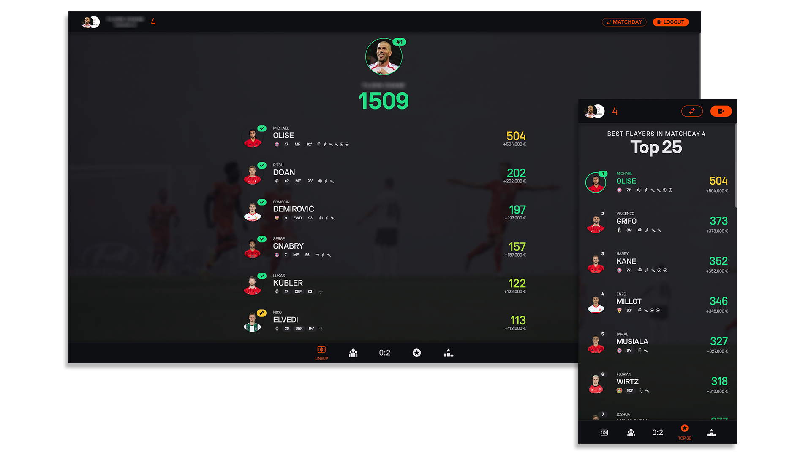

<p align="center">
    
</p>

<h1 align="center">
Kickbase Live
</h1>

<p align="center"><strong>Kickbase Live is an alternative web client for viewing matchday performances.</strong></p>

<div align="center">

<a href="https://kickbaselive.netlify.app/">


</a>


[](https://app.netlify.com/projects/kickbaselive/deploys)

<a href="https://buymeacoffee.com/simonsagstd">


</a>

</div>

<small>

> **Note:** This is a hobby project and was used for educational purposes to exercise and improve my skills while attending a reactjs training. I am not associated with Kickbase in any relation or responsible for the data provided by their API. I am not storing or analyzing any information/data within or outside the app. All data is stored inside your browsers local storage or indexed db.

## Summary

</small>

Kickbase Live is an alternative web client for **viewing performances of all matchdays**. It uses the **official Kickbase API v4** to retrieve the necessary data. The look is inspired by Kickbase and combines the Kickbase v3 layout with some of the new Kickbase v4 design patterns.

## Table of Contents

-   [Features](#features)
-   [Demo](#demo)
-   [Setup](#setup)
-   [Self-Hosting](#self-hosting)
-   [API](#api)
-   [Contributing](#contributing)
-   [License](#license)

## Features

-   Switch between your leagues
-   View past and running matchdays
-   Squad performance (your own and all other league manager)
-   Matchday results
-   Team players performance (specific match or all time)
-   Manager ranking
-   Team ranking
-   Top 25
-   Competition Leaderboard
-   Install as a progressive web app for mobile or desktop

## Demo

You can test this app with a demo I deployed on netlify [https://kickbase-live.web.app/](https://kickbaselive.netlify.app/)

> **Important information:**

> I am not storing your credentials. After the login the app makes a request to the offical Kickbase API to authenticate your account with their services. The app will receive an access token which will be stored locally in your browser. You can delete any data by logging out or deleting the application storage in the application tab within your browsers developer tools. The access token is valid for 7 days and you will be automatically logged out after it expires.

> <small>The demo website should be only used for testing or demonstration purposes. This way you dont have to donwload the source code and you can have an initial look at the application. If you want to fully benefit from this project you have to host it yourself or download and run it locally.</small>

## Setup

_Tested with Node v24.22.2_

Clone the repository

```bash
git clone https://github.com/simonsagstetter/kickbaselive.git
```

Navigate to project directory

```bash
cd kickbaselive/
```

Install all dependencies

```bash
npm install
```

For development

```bash
npm run dev
  ➜  Local:   http://localhost:5173/
  ➜  Network: http://0.0.0.0:5173/
  ➜  press h + enter to show help
```

Generate a production build

```bash
npm run build
```

Preview and test a production build

```bash
npm run preview
  ➜  Local:   http://localhost:4173/
  ➜  Network: http://0.0.0.0:4173/
  ➜  press h + enter to show help
```

## Self-Hosting

Kickbase Live is a static React/Vite app, so any web server can host it. Besides serving the files, the server has to do two things:

1. **Proxy `/api` to the Kickbase API.** This is the production equivalent of the Vite dev proxy. It also means the browser only talks to your own origin, so no CORS configuration is needed.
2. **Fall back to `index.html`** for client-side routes, so a page reload on a deep link doesn't return a 404.

### 1. Build the app

```bash
git clone https://github.com/simonsagstetter/kickbaselive.git
cd kickbaselive/
npm install
npm run build
```

Copy the contents of the generated `dist/` folder to your server, e.g. `/var/www/kickbaselive`.

### 2. Configure your web server

> **Note:** The examples below assume the app calls `/api/...` and that the Kickbase API lives at `https://api.kickbase.com`. If you changed the proxy in `vite.config.ts`, adjust the paths and target accordingly. Replace `kickbaselive.example.com` with your own domain.

#### nginx

```nginx
server {
    listen 80;
    server_name kickbaselive.example.com;
    root /var/www/kickbaselive;
    index index.html;

    # /api/v4/... -> https://api.kickbase.com/v4/...
    location /api/ {
        proxy_pass https://api.kickbase.com/;   # the trailing slash strips /api
        proxy_set_header Host api.kickbase.com;
        proxy_ssl_server_name on;
    }

    # Long-term caching for hashed build assets
    location /assets/ {
        add_header Cache-Control "public, max-age=31536000, immutable";
    }

    # SPA fallback
    location / {
        try_files $uri $uri/ /index.html;
        add_header Cache-Control "no-cache";
    }
}
```

Test and reload: `nginx -t && systemctl reload nginx`

#### Apache

Enable the required modules:

```bash
a2enmod proxy proxy_http ssl rewrite headers
systemctl restart apache2
```

```apache
<VirtualHost *:80>
    ServerName kickbaselive.example.com
    DocumentRoot /var/www/kickbaselive

    SSLProxyEngine On
    ProxyPass        /api/ https://api.kickbase.com/
    ProxyPassReverse /api/ https://api.kickbase.com/

    <Directory /var/www/kickbaselive>
        Options -Indexes
        AllowOverride None
        Require all granted

        # SPA fallback
        RewriteEngine On
        RewriteCond %{REQUEST_URI} !^/api/
        RewriteCond %{REQUEST_FILENAME} !-f
        RewriteCond %{REQUEST_FILENAME} !-d
        RewriteRule ^ /index.html [L]
    </Directory>
</VirtualHost>
```

#### Netlify / Vercel / Cloudflare Pages

Platforms with built-in rewrites need no web server config. Add a rule such as the following to `public/_redirects` (Netlify):

```
/api/*  https://api.kickbase.com/:splat  200
/*      /index.html                      200
```

### 3. Enable HTTPS

HTTPS is required if you want to install the app as a PWA (service workers only run in a secure context, except on `localhost`). It also keeps your Kickbase login and access token from travelling in plain text.

#### Option A: Let's Encrypt with certbot (recommended)

Make sure your domain's DNS points to your server and ports 80 and 443 are open. Then run:

```bash
# cerbot
sudo apt install snapd
sudo snap install --classic certbot
sudo ln -s /snap/bin/certbot /usr/local/bin/certbot

# nginx
sudo certbot --nginx -d kickbaselive.example.com

# Apache
sudo certbot --apache -d kickbaselive.example.com
```

Certbot obtains the certificate, edits your config to listen on 443, and adds an HTTP to HTTPS redirect. Check that automatic renewal works:

```bash
sudo certbot renew --dry-run
```

#### Option B: Manual configuration

If you already have a certificate (or manage your own), this is what the config should look like.

**nginx**

```nginx
# Redirect HTTP -> HTTPS
server {
    listen 80;
    server_name kickbaselive.example.com;
    return 301 https://$host$request_uri;
}

server {
    listen 443 ssl;
    http2 on;
    server_name kickbaselive.example.com;

    ssl_certificate     /etc/letsencrypt/live/kickbaselive.example.com/fullchain.pem;
    ssl_certificate_key /etc/letsencrypt/live/kickbaselive.example.com/privkey.pem;
    ssl_protocols       TLSv1.2 TLSv1.3;

    add_header Strict-Transport-Security "max-age=31536000; includeSubDomains" always;

    root /var/www/kickbaselive;
    index index.html;

    location /api/ {
        proxy_pass https://api.kickbase.com/;   # the trailing slash strips /api
        proxy_set_header Host api.kickbase.com;
        proxy_ssl_server_name on;
    }

    location /assets/ {
        add_header Cache-Control "public, max-age=31536000, immutable";
    }

    location / {
        try_files $uri $uri/ /index.html;
        add_header Cache-Control "no-cache";
    }
}
```

**Apache**

```bash
a2enmod ssl
systemctl restart apache2
```

```apache
<VirtualHost *:80>
    ServerName kickbaselive.example.com
    Redirect permanent / https://kickbaselive.example.com/
</VirtualHost>

<VirtualHost *:443>
    ServerName kickbaselive.example.com
    DocumentRoot /var/www/kickbaselive

    SSLEngine on
    SSLCertificateFile    /etc/letsencrypt/live/kickbaselive.example.com/fullchain.pem
    SSLCertificateKeyFile /etc/letsencrypt/live/kickbaselive.example.com/privkey.pem
    SSLProtocol           all -SSLv3 -TLSv1 -TLSv1.1

    Header always set Strict-Transport-Security "max-age=31536000; includeSubDomains"

    SSLProxyEngine On
    ProxyPass        /api/ https://api.kickbase.com/
    ProxyPassReverse /api/ https://api.kickbase.com/

    <Directory /var/www/kickbaselive>
        Options -Indexes
        AllowOverride None
        Require all granted

        # SPA fallback
        RewriteEngine On
        RewriteCond %{REQUEST_URI} !^/api/
        RewriteCond %{REQUEST_FILENAME} !-f
        RewriteCond %{REQUEST_FILENAME} !-d
        RewriteRule ^ /index.html [L]
    </Directory>
</VirtualHost>
```

> **Note:** `SSLProxyEngine On` (Apache) and `proxy_ssl_server_name on` (nginx) from step 2 are about the connection from your server to the Kickbase API. They are separate from the certificate for your own domain, and you need both.

#### Local network or testing without a domain

Let's Encrypt can't issue certificates for IP addresses or `.local` names. For a home server or local testing, use [mkcert](https://github.com/FiloSottile/mkcert) to create a locally trusted certificate, and point `ssl_certificate` / `SSLCertificateFile` at it. A plain self-signed certificate also works, but browsers will show a warning and may not allow PWA installation.

#### Behind a reverse proxy or CDN

If TLS is terminated upstream (Cloudflare, Traefik, a load balancer), the app server can stay on plain HTTP. Just make sure the proxy forwards `X-Forwarded-Proto: https`.

#### Troubleshooting

-   **404 on page reload:** the SPA fallback is missing.
-   **API calls return 404 or hit the wrong URL:** check the trailing slashes on `proxy_pass` / `ProxyPass`. They strip the `/api` prefix.
-   **Users don't see new versions after a deploy:** make sure `index.html` is not cached long-term.

## API

Im using the Kickbase v4 Endpoints which I have documented in my [Kickbase API v4 Docs](https://github.com/simonsagstetter/kickbase-api-v4-docs).

## Contributing

Contributions are welcome! Please see into [CONTRIBUTING.md](https://github.com/simonsagstetter/kickbaselive/blob/main/CONTRIBUTING.md) for details on the code of conduct and submission process.

### Roadmap

-   Player details
    -   Season perfomance and stats
    -   Market value insights
    -   A performance evaluation algorithm
    -   Player event history for the currently active matchday
-   Show match events and announced team lineup when clicking on the score within "standings" tab

### Contributors

<!-- ALL-CONTRIBUTORS-LIST:START - Do not remove or modify this section -->
<!-- prettier-ignore-start -->
<!-- markdownlint-disable -->
<table>
  <tbody>
    <tr>
      <td align="center" style="border: 1px solid transparent"><a href="https://github.com/simonsagstetter"><br /><sub><b>simonsagstetter</b></sub></a></td>
    </tr>
  </tbody>
</table>

<!-- markdownlint-restore -->
<!-- prettier-ignore-end -->

<!-- ALL-CONTRIBUTORS-LIST:END -->

## License

This project is licensed under the MIT License - see the [LICENSE](LICENSE) file for details
